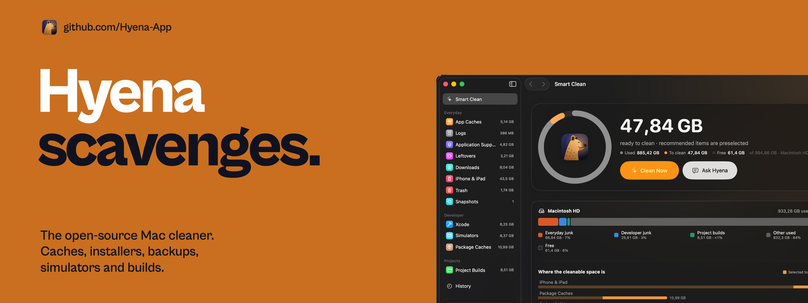

  <b>Hyena</b> finds what piles up on your Mac — caches, old installers, iPhone backups, 
  simulators, Trash, leftovers from deleted apps, and developer builds like <code>node_modules</code> — 
  explains it on-device, and clears it only when you say so.

  <a href="https://hyena-app.github.io">Website</a> ·
  <a href="https://github.com/Hyena-App/hyena">Source</a> ·
  <a href="https://github.com/Hyena-App/hyena/blob/main/CONTRIBUTING.md">Contribute</a> ·
  <a href="https://github.com/Hyena-App/hyena/issues">Issues</a>

- 🔒 **Private by design.** Scanning, explanations and suggestions run on your Mac. Nothing is uploaded.
- 🧹 **For every Mac.** App caches, Downloads, iPhone & iPad, Trash, snapshots, leftovers.
- 🛠️ **Sharp for developers.** Eighteen ecosystems, each matched by its marker file, plus Xcode, simulators and package caches.
- ✅ **You decide.** Every path is reviewed by you and checked again right before it's removed.
- 🦴 Native SwiftUI · macOS 14+ · MIT licensed · contributions welcome
